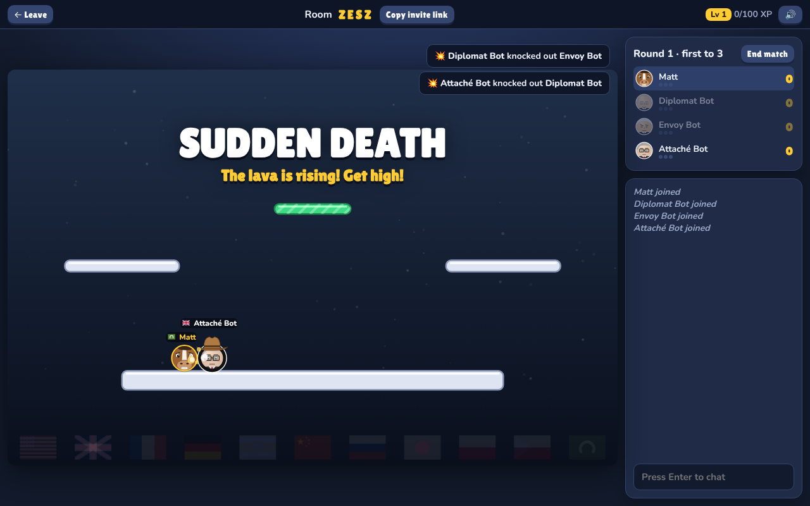

# Summit Smash

A multiplayer physics party game for the browser. Pick a world leader (or a horse), roll your ball around, and knock your friends off the map. Last ball standing wins the round, and first to 5 rounds wins the match.



## Features
- **11 characters:** cartoon caricatures of the leaders of the USA, UK, France, Germany, Israel, China, Russia, Japan, Poland and Czechia, plus **The Horse**.
- **Play with friends:** create a room and send the invite link (or the 4-letter code). Up to 8 players per room.
- **Bots:** add bots to fill a room or practise alone.
- **Accounts and XP:** sign up to earn XP, level up, unlock hats (party hat, top hat, cowboy hat, viking helmet, chef hat, crown, halo), track stats and get on the leaderboard. Guests can play without an account but earn no XP.
- **7 maps:** Summit Hall, Round Table, Iron Curtain, Bouncy Castle, Moving Day, The Valley, Ice Rink. Bouncy (green), ice (blue) and lava (red) surfaces.
- **Sudden death:** after 40 seconds, lava rises from below, so stay high.
- **Phone support:** on-screen buttons on touch devices.

## Controls
| Key | Action |
| --- | --- |
| ← → / A D | Roll |
| ↑ / W | Float (slows falling) |
| ↓ / S | Dive |
| X / Space / Shift | Heavy: hit harder, steer slower |
| Enter | Chat |

## XP
+10 per round played, +25 per round won, +8 per knockout, +100 for winning a match. If the only other players are bots, you get half XP.

## Run it on your computer
Needs [Node.js](https://nodejs.org) 18 or newer.
```bash
npm install
npm start
```
Open http://localhost:3000. Friends on the same Wi-Fi can open `http://YOUR-COMPUTER-IP:3000`.

To let friends anywhere join while it runs on your computer, use a free tunnel such as [Cloudflare Tunnel](https://developers.cloudflare.com/cloudflare-one/connections/connect-networks/do-more-with-tunnels/trycloudflare/):
```bash
cloudflared tunnel --url http://localhost:3000
```
Then send friends the `https://….trycloudflare.com` link it prints.

## Put it online 24/7
Any host that runs Node.js and supports WebSockets works (Render, Railway, Fly.io, a VPS). Settings:
- **Start command:** `npm start` (a `Dockerfile` is also included)
- **Port:** taken from the `PORT` environment variable automatically
- **Accounts:** saved to `data/accounts.json`, or to the folder in the `DATA_DIR` environment variable. **On free hosting tiers the disk is usually wiped on every restart or redeploy, which deletes all accounts and XP.** To keep them, attach a persistent disk or volume and set `DATA_DIR` to it.

## Editing
- Leader names: `public/characters.js` (update when a country's leader changes)
- Caricature drawings and hats: `public/avatars.js`
- Maps: `server/maps.js`
- Physics feel (speed, gravity, bounciness): top of `server/physics.js`
- Round rules and XP amounts: top of `server/game.js`
